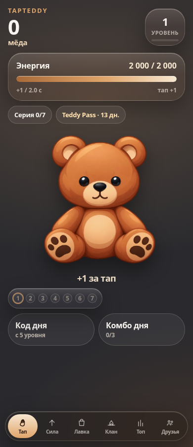

# TapTeddy

Тапалка в Telegram Mini App. Мишка по центру экрана, мёд за тапы, энергия с регеном, карты, серия, рефералка, соло- и клановый рейтинг, окрасы и оплаты звёздами Telegram (XTR). Случайных платных ящиков нет: у каждой покупки фиксированный состав.

Бот: [@TapTeddy_bot](https://t.me/TapTeddy_bot). Валюта в игре — **мёд**. Звёзды получает только владелец бота, вывода нет.



## Стек

- Node.js 22, TypeScript
- Один процесс: HTTP API, раздача фронта и long polling бота
- SQLite через встроенный `node:sqlite` (отдельная база не нужна)
- Vite + React

Один инстанс. SQLite и long polling не рассчитаны на несколько реплик.

## Локальный запуск

Нужен Node.js 22+.

```bash
cp .env.example .env
```

В `.env` на локальной машине оставь `DEV_MODE=1` и задай секрет:

```bash
node -e "console.log(require('crypto').randomBytes(32).toString('hex'))"
```

Вставь результат в `SESSION_SECRET`. `BOT_TOKEN` для локальной игры без Telegram можно не заполнять.

```bash
npm install
npm test
npm run dev
```

Открой http://localhost:5173 . Без Telegram поднимется локальный игрок «Мишка» (id `10001`). Другой аккаунт: http://localhost:5173/?dev=10002 . Рефералка локально: `?dev=10002&startapp=ref_10001`.

`npm run dev` поднимает API на порту 3000 и Vite на 5173. Vite проксирует `/api`.

Проверка типов и прод-сборка:

```bash
npm run build
npm start
```

`npm start` отдаёт собранный фронт и API с одного порта (`PORT`, по умолчанию 3000).

## Переменные

| Переменная | Зачем |
|---|---|
| `BOT_TOKEN` | Токен от BotFather. Не коммитить. |
| `BOT_USERNAME` | Юзернейм без `@`. По умолчанию `TapTeddy_bot`. |
| `WEBAPP_URL` | Публичный HTTPS мини-приложения. Локально можно `http://localhost:5173`. |
| `CHANNEL_URL` | Ссылка на канал с кодом дня. Можно пустой. |
| `PORT` | Порт процесса. На хостинге часто задаётся сам. |
| `DATABASE_PATH` | Файл SQLite. Относительный путь считается от корня репозитория. |
| `SESSION_SECRET` | Подпись сессий. Длинная случайная строка. |
| `DEV_MODE` | `1` локально: вход без Telegram и тестовые покупки без звёзд. **На бою строго `0`.** |
| `ADMIN_IDS` | Telegram id через запятую. Им доступны `/dailycode` и `/refund`. Свой id бот пишет в ответ на `/start`. |
| `SUPPORT_USERNAME` | Куда вести игрока по оплате, без `@`. |
| `DAILY_CODE_SALT` | Соль утреннего кода. Если пусто, при первом запуске случайная соль пишется в SQLite. |

Файл `.env` в git не попадает. Шаблон — `.env.example`.

## BotFather

1. Открой [@BotFather](https://t.me/BotFather).
2. `/newbot`. Имя: `TapTeddy`. Юзернейм: `TapTeddy_bot` (если занят — другой, и его же в `BOT_USERNAME`).
3. Скопируй токен в `BOT_TOKEN`.
4. Задеплой игру по HTTPS (ниже) и пропиши этот адрес в `WEBAPP_URL`.
5. Меню бота. Либо перезапусти процесс: при `WEBAPP_URL` на `https://` бот сам вызывает `setChatMenuButton` и ставит кнопку «Играть». Либо вручную: `/mybots` → бот → **Bot Settings** → **Menu Button** → **Edit menu button URL** → вставь `https://твой-домен`.
6. Прямая ссылка мини-приложения: `/mybots` → бот → **Bot Settings** → **Configure Mini App** (или команда `/newapp`) → URL тот же `https://твой-домен`. Короткая ссылка будет вида `https://t.me/<bot>/<app>`.
7. Описание и команды можно не задавать руками: при старте бот регистрирует `/start`, `/help`, `/paysupport`.

Адрес должен быть HTTPS с нормальным сертификатом. `http://` и голый IP Telegram для Mini App не примет.

Свой числовой id: напиши боту `/start` и добавь его в `ADMIN_IDS`, затем перезапусти процесс.

## Звёзды (XTR)

Отдельный платёжный провайдер не нужен. Счета создаёт Bot API `createInvoiceLink` с `currency: "XTR"`. Бот в том же процессе отвечает на `pre_checkout_query` и обрабатывает `successful_payment`. Покупка пишется в SQLite.

Игрок открывает счёт из лавки. Если звёзды списались, а предмет не пришёл — команда `/paysupport`. Возврат целиком: `/refund <telegram_payment_charge_id>` (только `ADMIN_IDS`). Снимаются неиспользованные жетоны и оставшееся время бустов. Мёд из набора забирается, только если он ещё на балансе. Потраченное в карты не выдирается.

Локально без Telegram кнопка покупки проводит тестовую выдачу (`dev_buy`), только при `DEV_MODE=1`. На бою эта ветка закрыта.

## Деплой

Нужны Node 22, один процесс и постоянный диск под SQLite. Бесплатный инстанс без диска сотрёт базу при перезапуске.

### Общее

```bash
npm ci
npm run build
npm start
```

Переменные боя как минимум:

```
BOT_TOKEN=...
BOT_USERNAME=TapTeddy_bot
WEBAPP_URL=https://твой-домен
SESSION_SECRET=...
DEV_MODE=0
ADMIN_IDS=твой_telegram_id
DATABASE_PATH=/data/tapteddy.sqlite
PORT=3000
```

Проверка живости: `GET /health` → `{"ok":true,"name":"tapteddy"}`.

### Render

1. New → Web Service → этот репозиторий. Environment: Docker (в корне есть `Dockerfile`) либо Native Node, build `npm ci && npm run build`, start `npm start`.
2. Instance count: **1**.
3. Environment: переменные из таблицы выше, `DEV_MODE=0`.
4. Disk: смонтируй, например, `/data` и поставь `DATABASE_PATH=/data/tapteddy.sqlite`. Без диска база пропадёт.
5. Health check path: `/health`.
6. После деплоя возьми `https://….onrender.com` и впиши его в `WEBAPP_URL`, затем в BotFather (шаги выше). Перезапусти сервис, чтобы бот записал кнопку меню.

### Railway

1. New Project → Deploy from GitHub. Railway подхватит `Dockerfile`.
2. Variables: те же, `DEV_MODE=0`.
3. Volume смонтируй в `/data`, `DATABASE_PATH=/data/tapteddy.sqlite`.
4. Включи публичный домен, пропиши его в `WEBAPP_URL` и в BotFather.
5. Реплика одна.

### VPS (systemd + nginx)

```bash
sudo apt update && sudo apt install -y nginx certbot python3-certbot-nginx
# Node 22: https://nodejs.org или NodeSource
git clone <репозиторий> /opt/tapteddy
cd /opt/tapteddy
cp .env.example .env   # заполни, DEV_MODE=0, DATABASE_PATH=/var/lib/tapteddy/tapteddy.sqlite
sudo mkdir -p /var/lib/tapteddy && sudo chown "$USER" /var/lib/tapteddy
npm ci
npm run build
```

`/etc/systemd/system/tapteddy.service`:

```ini
[Unit]
Description=TapTeddy
After=network.target

[Service]
WorkingDirectory=/opt/tapteddy
EnvironmentFile=/opt/tapteddy/.env
ExecStart=/usr/bin/npm start
Restart=on-failure
User=tapteddy

[Install]
WantedBy=multi-user.target
```

```bash
sudo systemctl daemon-reload
sudo systemctl enable --now tapteddy
```

Nginx проксирует `https://домен` на `127.0.0.1:3000`, сертификат — `sudo certbot --nginx -d домен`. В `WEBAPP_URL` и в BotFather — этот `https://домен`.

## Команды бота

| Команда | Кто | Что делает |
|---|---|---|
| `/start` | все | Приветствие, кнопка «Играть», твой Telegram id. Аргумент `ref_<id>` или `clan_<код>` запоминается до входа в игру. |
| `/help` | все | Короткие правила. |
| `/paysupport` | все | Куда писать, если звёзды списались, а товар не пришёл. |
| `/dailycode` | `ADMIN_IDS` | Код дня (UTC), чтобы выложить его в канал. |
| `/refund <charge_id>` | `ADMIN_IDS` | Возврат звёзд целиком и откат неиспользованной выдачи. |

Реферальная ссылка: `https://t.me/<бот>?startapp=ref_<telegram_id>`. Клановая: `https://t.me/<бот>?startapp=clan_<код>`.

## Игра коротко

- Тап тратит 1 энергию. Мёд за тап: `floor(мультитап × (1 + карты силы, потолок +300%) × пропуск × x2 × клановый буст)`.
- Бак: `2000 + 250×(уровень бака − 1) + 20×(уровень − 1)` плюс карты. Реген с 1/2 с, быстрее 1.2 с не разгоняется.
- Сервер сам считает энергию и принимает тапы пачками. Потолок входящих: запас 16 и дальше 12 в секунду. Клиенту баланс не доверяем.
- Опыт — заработанный мёд (тап, пассив, дейли). Мёд из наборов за звёзды опыт и сезон не качает.
- 48 карт в четырёх темах: Берлога, Игрушки, Пикник, Редкое. Цифры карт и цены — в `server/src/catalog.ts`, формулы — в `server/src/economy.ts`.
- Серия на 7 дней, код дня, комбо из трёх карт. Оффлайн-копилка 3 часа, с Teddy Pass — 8.
- Клан с 8 уровня: код, ссылка, опционально канал, где бот — админ. Неделя с понедельника 00:00 UTC.
- Окрасы — CSS-фильтры того же мишки (`web/public/bear.png`). На доход не влияют.

## Тесты

```bash
npm test
```

Проверяются формулы, ведро антиавтокликера, подпись `initData`, сессия, тапы, обрезка пачки, набор за звёзды без опыта, возврат, рефералка.
